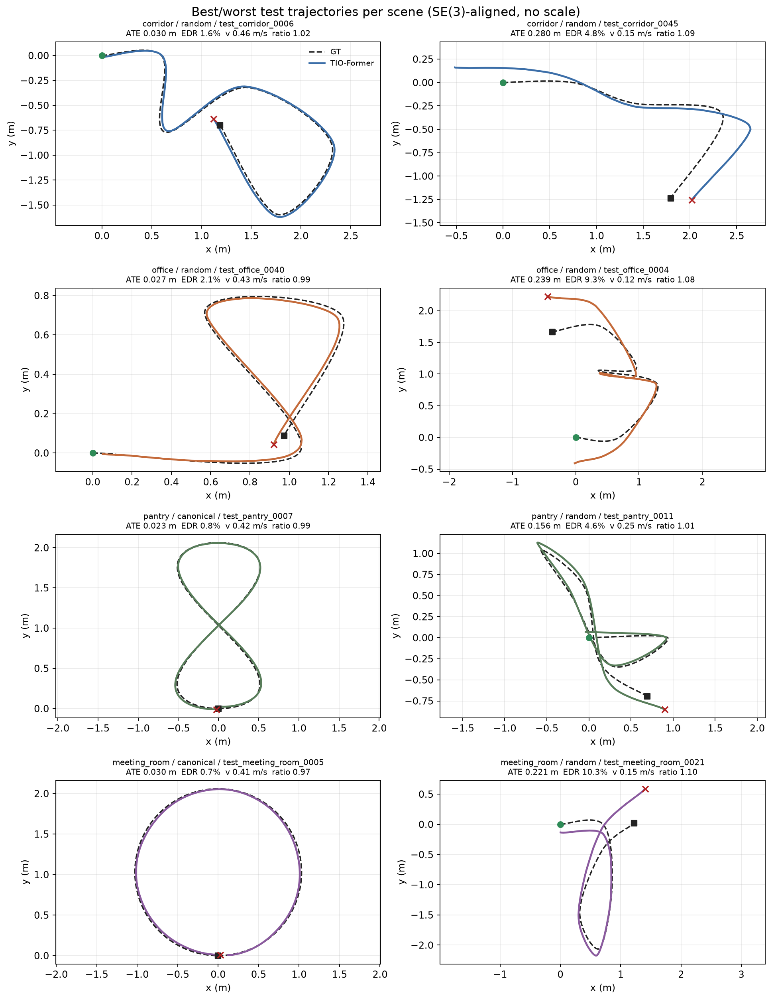
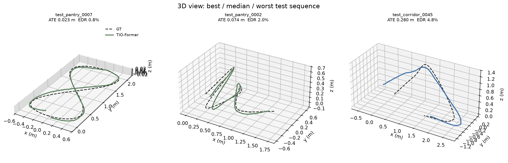
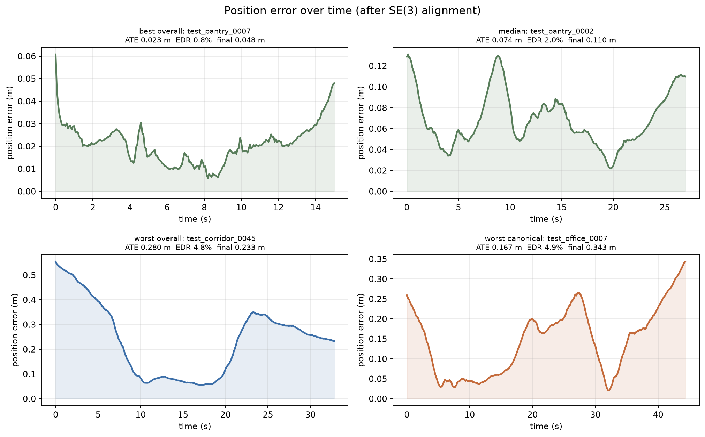
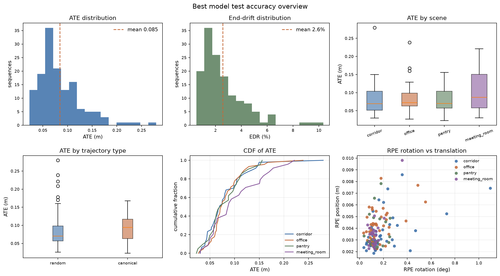
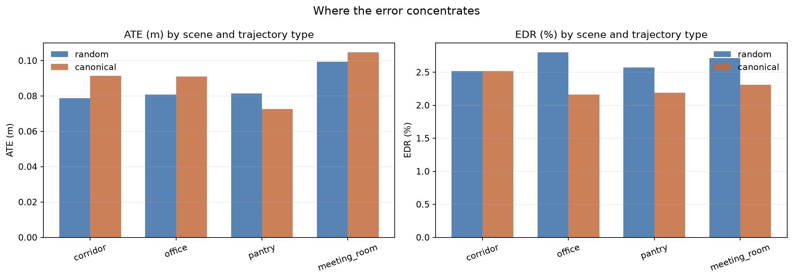
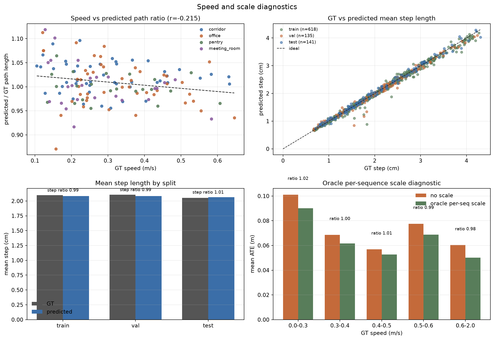
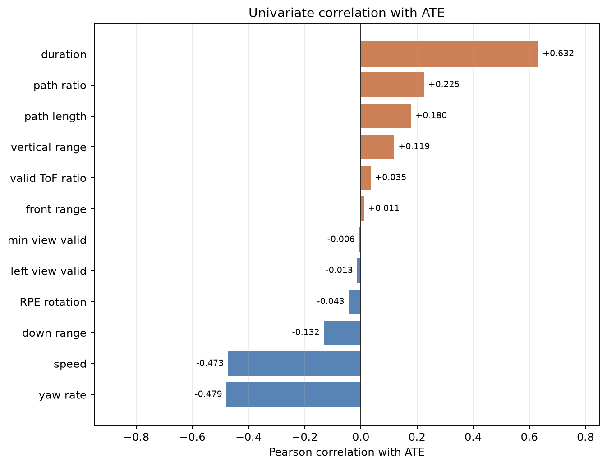
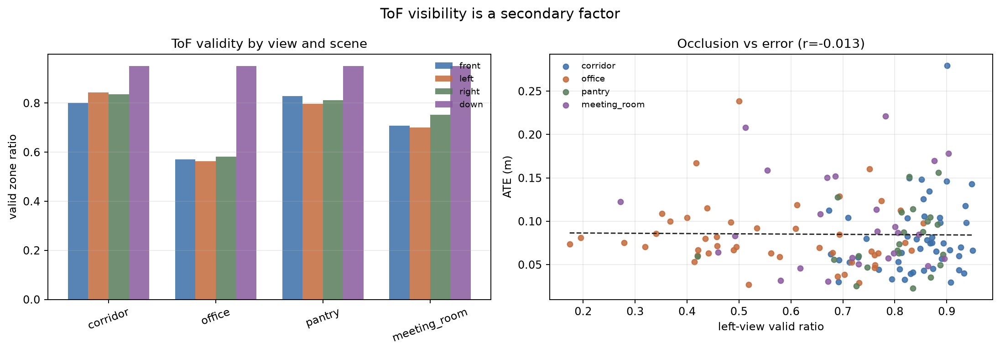
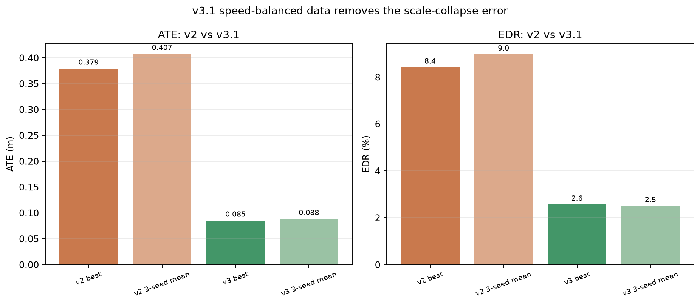

# TIO-Former v3.1 最佳模型：轨迹、精度与失效因素分析

图表/JSON 脚本：`scripts/analyze_best_model.py`<br>
分析文字：根据 v3.1 seed1 结果整理<br>
模型检查点：`checkpoints_v3/main/seed1/best.pt`（epoch 57）<br>
数据：v3.1，`data_v3/processed`（894 序列 / 22,927.5 s / 6,229.5 m）<br>
分支：`dev/odom-tio`

说明：这里展示 3 个 seed 中测试 ATE 最好的 seed 1。总体结论仍以
3-seed 均值 **ATE 0.0879 ± 0.0025 m / EDR 2.518 ± 0.057%** 为准，
不能把 best-of-3 当作无偏指标。

## 1. 结论摘要

- seed 1 在 **141 条 test 序列、3,120.2 s、790.9 m** 上：
  **ATE 0.0848 m、RPEp 0.00375 m、RPER 0.162°、EDR 2.58%**。
- v2 最严重的**平移尺度塌缩已经消失**：预测/GT 路径比为 **1.009**，
  平均最优尺度为 **0.993×**；oracle 逐序列尺度修正只把 ATE 从
  0.0848 m 降到 0.0758 m（约 10.6%），不再是 v2 中 47% 量级的
  主导误差。
- 训练/验证/测试误差一致：train ATE 0.0968 m、val 0.1058 m、
  test 0.0848 m；三个 split 的预测/GT 路径比都在 0.994–1.009。
- 剩余误差与**速度、序列时长和偏航率**相关：速度 r=−0.473、
  时长 r=+0.632、偏航率 r=−0.479。慢速/长时序列仍有绝对误差累积，
  但已经不是速度相关的尺度增益缺失。
- ToF 有效率与 ATE 的相关性只有 +0.035；office 有效率最低（0.666）
  但 ATE 0.0828 m，说明遮挡是次要因素。

## 2. 轨迹叠加



每个场景给出 ATE 最好和最差的测试序列。GT 为黑色虚线，TIO-Former 为彩色实线，
绿色圆点为起点，黑色方块为 GT 终点，红色叉号为预测终点。v3.1 中预测轨迹
与 GT 的长度基本一致，不再出现 v2 中“整体缩水”的现象。





## 3. 精度统计



| scene | n | ATE m | RPEp m | RPER deg | EDR % | mean speed m/s | valid ratio | pred/GT path |
|---|---:|---:|---:|---:|---:|---:|---:|---:|
| corridor | 48 | 0.0806 | 0.00351 | 0.198 | 2.52 | 0.304 | 0.857 | 1.020 |
| office | 46 | 0.0828 | 0.00413 | 0.154 | 2.68 | 0.328 | 0.666 | 1.006 |
| pantry | 22 | 0.0799 | 0.00365 | 0.142 | 2.50 | 0.314 | 0.847 | 0.999 |
| meeting_room | 25 | 0.1011 | 0.00360 | 0.127 | 2.58 | 0.274 | 0.778 | 1.003 |



| split | n | ATE m | RPEp m | RPER deg | EDR % | path-weighted speed m/s | GT step cm | pred step cm | pred/GT path |
|---|---:|---:|---:|---:|---:|---:|---:|---:|---:|
| train | 618 | 0.0968 | 0.00339 | 0.133 | 2.17 | 0.274 | 2.10 | 2.08 | 0.994 |
| val | 135 | 0.1058 | 0.00357 | 0.149 | 2.52 | 0.277 | 2.11 | 2.08 | 0.995 |
| test | 141 | 0.0848 | 0.00375 | 0.162 | 2.58 | 0.253 | 2.05 | 2.06 | 1.009 |

canonical 轨迹 ATE 0.0924 m，random 0.0830 m，差距已从 v2 的
0.54 m vs 0.34 m 缩小到约 0.01 m；旋转误差也没有随轨迹类型明显恶化。

## 4. 速度与尺度诊断



- test 的逐序列平均速度为 0.308 m/s（路径加权 0.253 m/s）。
- speed 与 pred/GT path ratio 的相关系数为 **−0.215**，接近无关；
  速度与 ATE 的相关系数为 **−0.473**：慢速序列的绝对误差略高，
  但路径长度不再随速度塌缩。
- path ratio 与 ATE 的相关系数为 **+0.225**，尺度误差不再是 ATE 的主因。
- 平均最优尺度 **0.993×**，说明模型整体既不过冲也不欠冲。

| speed m/s | n | ATE m | oracle-scale ATE m | pred/GT path | mean optimal scale |
|---|---:|---:|---:|---:|---:|
| 0.0–0.3 | 77 | 0.1011 | 0.0900 | 1.016 | 0.986 |
| 0.3–0.4 | 27 | 0.0686 | 0.0616 | 1.004 | 1.002 |
| 0.4–0.5 | 23 | 0.0568 | 0.0526 | 1.005 | 0.999 |
| 0.5–0.6 | 10 | 0.0776 | 0.0688 | 0.994 | 0.994 |
| 0.6–2.0 | 4 | 0.0603 | 0.0501 | 0.982 | 1.018 |

低速段（<0.3 m/s）ATE 0.101 m，仍高于中速段；原因是 8×8 ToF 的单帧
角分辨率约 5.6°、1 cm 级测距噪声和低速小位移同量级，模型对 1–2 cm
级位移的信噪比更低。但低速段的路径比仍是 1.016，说明这是**噪声底**
而不是尺度塌缩。

### 与 v2 的差异

| 版本 | ATE m | EDR % | pred/GT path | oracle-scale ATE m |
|---|---:|---:|---:|---:|
| v2 最佳 seed | 0.3788 | 8.42 | 0.567 | 0.2003 |
| v2 3-seed 均值 | 0.4073 | 8.98 | — | — |
| **v3.1 seed1** | **0.0848** | **2.58** | **1.009** | **0.0758** |
| **v3.1 3-seed 均值** | **0.0879 ± 0.0025** | **2.518 ± 0.057** | **~1.00** | — |

v3.1 的主要改动是统一 train/val/test 速度分布、关闭合成 status=10、
加入 dropout/reflectivity、增加垂直运动，并修正 checkpoint 选择规则。
这些改动让模型不再回归“平均步长先验”，而是恢复出接近真实的平移尺度。

## 5. 其他因素



| feature | Pearson r with ATE |
|---|---:|
| speed | −0.473 |
| path length | +0.180 |
| duration | +0.632 |
| valid ToF ratio | +0.035 |
| left view valid | −0.013 |
| vertical range | +0.119 |
| yaw rate | −0.479 |
| pred/GT path ratio | +0.225 |
| RPE rotation | −0.043 |

- **时长是最强的正相关因素**（r=+0.632）：更长的序列给误差累积更多时间，
  这与 EDR 仍然存在一致。
- **偏航率与 ATE 负相关**（r=−0.479）：转弯多的序列往往更短、更慢，
  是时长/速度的混杂因素，不代表转弯更准。
- **ToF 有效率几乎不相关**（r=+0.035）。office 有效率 0.666、ATE 0.0828 m，
  pantry 有效率 0.847、ATE 0.0799 m，遮挡不是当前主要瓶颈。
- 旋转仍然很准：RPER 0.162°，RPE rotation 与 ATE 的相关性接近 0。



## 6. 版本对比



- v2 最佳 seed：ATE 0.3788 m、EDR 8.42%、路径比 0.567。
- v2 3-seed 均值：ATE 0.4073 m、EDR 8.98%。
- v3.1 seed1：ATE 0.0848 m、EDR 2.58%、路径比 1.009。
- v3.1 3-seed 均值：ATE 0.0879 m、EDR 2.518%。

v3.1 的 ATE 相对 v2 最佳 seed 降低约 **77.6%**。这一提升主要来自数据
分布和 checkpoint 选择，而不是模型结构变化；因此不应把 v2 的
`naive_concat`/`kv_only_no_fifo` 负消融结果直接外推到 v3.1。

## 7. 限制与下一步

- 所有结果仍来自四个 Gazebo 场景的仿真，真实 VL53L5CX 的噪声、遮挡、
  安装误差和 IMU 时间同步会重新引入域差距。
- 真实 TIO ROS 链路目前仍使用 v2 导出的 TorchScript
  `libflyrat/models/tio_former_window64.pt`；v3.1 模型需要重新导出后
  才能做真机对比。
- 旧布局真机静态 20 s 漂移约 0.98 m 的问题尚未在新布局/新模型上复测。
- 下一步优先级：重新导出 v3.1 模型 → 净空静态/匀速直线真机测试 →
  检查慢速段漂移 → 再考虑飞行闭环。
- 若真机仍有时长相关漂移，应优先做跨窗口状态传递或长时轨迹约束，
  而不是继续增加模型结构。

## 8. 复现

```bash
# 评估 seed1 的 train/val/test
PYTEST_DISABLE_PLUGIN_AUTOLOAD=1 .venv/bin/python scripts/evaluate.py \
  --checkpoint checkpoints_v3/main/seed1/best.pt \
  --processed data_v3/processed --split test --out runs_v3/eval_seed1
PYTEST_DISABLE_PLUGIN_AUTOLOAD=1 .venv/bin/python scripts/evaluate.py \
  --checkpoint checkpoints_v3/main/seed1/best.pt \
  --processed data_v3/processed --split train --out runs_v3/eval_best_train
PYTEST_DISABLE_PLUGIN_AUTOLOAD=1 .venv/bin/python scripts/evaluate.py \
  --checkpoint checkpoints_v3/main/seed1/best.pt \
  --processed data_v3/processed --split val --out runs_v3/eval_best_val

# 轨迹/精度/失效分析
.venv/bin/python scripts/analyze_best_model.py \
  --eval runs_v3/eval_seed1 --processed data_v3/processed \
  --stats data_v3/stats.json \
  --split-eval train=runs_v3/eval_best_train \
  --split-eval val=runs_v3/eval_best_val \
  --out report/best_model
```
