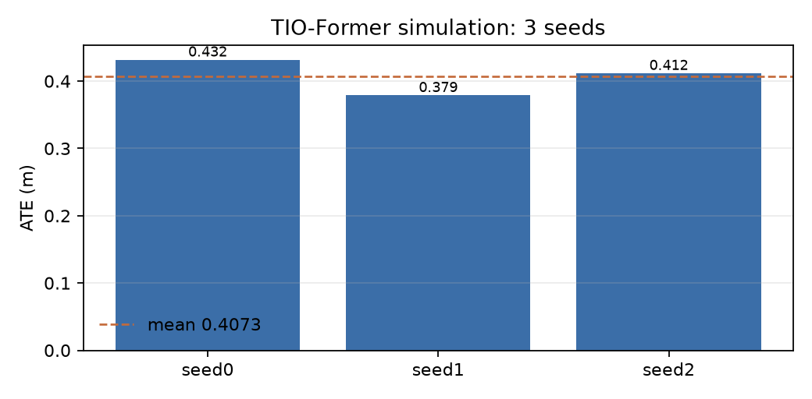
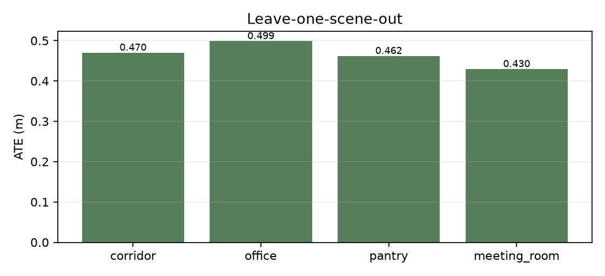

# TIO-Former 仿真复现技术报告

> 论文：TIO-Former: Ultra-Lightweight 6-Directional ToF-Inertial Odometry for
> Nano-UAVs via a Streaming Causal Transformer（arXiv:2609.17198）
>
> 本报告为 clean-room 仿真复现，使用 FlyRat 现有 4× VL53L5CX 8×8 ToF
> （前/左/右/下）与 200 Hz IMU，不等同于论文的 6× TOFSense-M 真飞系统。

## 1. 摘要

本工作从论文文本与公开图片出发，独立实现了 TIO-Former 的可靠性感知 ToF
前端、4 视角空间编码、IMU 引导的方向融合、Local KV + Chunk-FIFO 流式
Transformer 与多视界位姿监督，并在 Gazebo Harmonic 中构建了四个室内场景、
4 向 ToF rig 和全量数据集。最终系统在 103 条仿真测试序列上取得
**3 seeds 平均 ATE 0.4073 ± 0.0218 m、RPEp 0.0179 ± 0.0005 m、
RPER 0.315 ± 0.061°、EDR 8.98 ± 0.43%**（seed 0 为 ATE 0.4316 m、
RPER 0.257°）；逐帧流式推理在 RTX 3060 上均值 1.95 ms、P95 2.31 ms，
满足 15 Hz 预算。

需要强调的是：在本 4 向仿真设置下，完整模型的 cross-attention + Chunk-FIFO
并未超过 `naive_concat` 与 `kv_only_no_fifo` 消融，ToF 分支的贡献也明显弱于
论文的 6 向真飞结果。本报告如实记录这些负结果，并将其归因于传感器数量、
场景复杂度、解析 IMU 与真机 IMU 的差异，而不是声称复现了论文主表数值。

## 2. 复现范围与验收

- 复现级别：仿真复现，不包含真机飞行。
- 数据来源：Gazebo 离线轨迹 + ray-cast ToF + 解析 IMU + 仿真 GT。
- ToF：4 向（前/左/右/下），8×8，15 Hz；不使用论文的 6 向 TOFSense-M。
- 官方代码/数据/权重：未公开，全部 clean-room 实现。
- 部署：先完成 Python/PyTorch 原型，C++/RK3566 部署后置。
- 验收：完整模型相对核心消融有合理趋势、鲁棒性趋势合理、原型满足
  66.7 ms/step 实时预算；不要求复现论文精确数值。

## 3. 仿真数据

四个场景：走廊 corridor、办公室 office、储藏/茶水间 pantry、会议室
meeting_room。场景由程序化几何与 Gazebo Fuel 家具 mesh 混合构成，
包含墙、柱、桌椅、柜子、冰箱、货架、沙发等障碍物。

数据统计：

| 项目 | 数值 |
|---|---:|
| 序列数 | 324 |
| 总时长 | 9,728.9 s |
| 总轨迹长度 | 2,081.6 m |
| ToF 帧数 | 146,265 |
| 随机划分 train/val/test | 165 / 56 / 103 |
| 有效 ToF zone 比例 | 85.7%（场景 75.2%–97.0%） |

每条序列包含 `tof [T,4,8,8]`、`tof_ideal`、`tof_status`、`tof_weight`、
`gt_pose [T,7]`、`gt_twist [T,6]`、`imu [T,16,6]`、`t_tof`、`t_imu`。
轨迹 20% 为圆/8 字/方形/直线等规范运动，80% 为随机平滑 3D 飞行；
测试序列长度为 4–7 m。ToF 仿真包含 FoV、遮挡、量程、AR(1) 噪声、
随机丢失、状态码与反射率丢失；IMU 由 GT 轨迹解析求导并叠加噪声、
随机游走与零偏。

## 4. 方法实现

### 4.1 可靠性感知 ToF 前端

- 根据状态码与量程构造可靠性权重 `A_t`；VL53L5CX 有效状态映射为 1，
  新目标/低置信度为 0.5，无效为 0。
- 对无效像素做因果插补：优先使用上一帧，其次使用当前帧邻域中值；
  插补像素的权重保持为 0。
- 构造双边门控差分 `ΔD_t = A_{t-1} ⊙ A_t ⊙ (D̃_t − D̃_{t-1})`，
  输入通道为 `[D̃_{t-1}, D̃_t, ΔD_t]`。

### 4.2 空间与惯性编码

- 所有视角共享一个 2D CNN，将 8×8 range 图编码为 128 维 token；
  加入可学习视角 embedding 后，经过 2 层 view Transformer 得到 4 个
  方向 token。
- IMU 窗口 `[16,6]` 经过 3 层 1D CNN 编码为 128 维惯性 token。

### 4.3 方向融合与流式 Transformer

- 完整模型以 IMU token 为 query、4 个视角 token 为 key/value 做
  multi-head cross-attention，并保留 IMU 残差。
- 2 层因果流式 Transformer，每层 Local KV 容量 C=8、chunk G=4、
  FIFO 容量 S=4；FIFO 保存被驱逐 chunk 的池化摘要，保证每步计算量
  与显存有界。
- 位姿头输出 body-frame 增量 `(Δp, Δφ)`，再递归积分得到世界位姿。

### 4.4 损失

实现论文的逐步 Smooth L1、位置/旋转多视界损失、尺度损失与残差损失，
权重与 beta 使用论文值。训练在 bf16 autocast 下前向，损失与 SO(3)
运算强制 float32，以避免小角度/近 π 数值问题。

## 5. 训练与评估设置

- 单卡 RTX 3060 Laptop，batch 32，AdamW lr 1e-3，warmup+cosine，
  grad accumulation 2，bf16，early stopping patience 15。
- 主模型 40 epochs；核心消融统一 15 epochs（full 复用 40 epochs 主模型）。
- 指标：SE(3) no-scale 对齐后的 ATE、RPEp、RPER（66.7 ms）与 EDR。
- 3 seeds：0/1/2；主表报告 mean±std。

## 6. 主结果

单 seed（seed 0）在 103 条测试序列上的结果：

| 指标 | 值 |
|---|---:|
| ATE position (m) | 0.4316 |
| RPE position (m) | 0.0186 |
| RPE rotation (deg) | 0.257 |
| End drift (%) | 9.49 |

| 场景 | 序列 | ATE (m) | RPEp (m) | RPER (deg) | EDR (%) |
|---|---:|---:|---:|---:|---:|
| corridor | 35 | 0.3977 | 0.0176 | 0.258 | 9.32 |
| meeting_room | 20 | 0.3944 | 0.0165 | 0.230 | 9.01 |
| office | 32 | 0.4875 | 0.0209 | 0.231 | 10.23 |
| pantry | 16 | 0.4407 | 0.0185 | 0.340 | 8.96 |

| seed | ATE (m) | RPEp (m) | RPER (deg) | EDR (%) |
|---|---:|---:|---:|---:|
| 0 | 0.4316 | 0.0186 | 0.257 | 9.49 |
| 1 | 0.3788 | 0.0173 | 0.399 | 8.42 |
| 2 | 0.4116 | 0.0180 | 0.290 | 9.03 |
| **mean ± std** | **0.4073 ± 0.0218** | **0.0179 ± 0.0005** | **0.315 ± 0.061** | **8.98 ± 0.43** |



## 7. 核心消融

| 变体 | seeds | ATE (m) | RPEp (m) | RPER (deg) | EDR (%) |
|---|---:|---:|---:|---:|---:|
| full | 0 | 0.4316 | 0.0186 | 0.257 | 9.49 |
| imu_only | 0 | 0.4464 | 0.0191 | 0.541 | 9.93 |
| tof_only | 0 | 0.6636 | 0.0187 | 5.743 | 18.70 |
| naive_concat | 0 | 0.4013 | 0.0186 | 0.754 | 9.67 |
| memoryless | 0 | 0.4648 | 0.0196 | 0.669 | 10.55 |
| kv_only_no_fifo | 0 | 0.3925 | 0.0191 | 0.705 | 8.67 |

结论：

- 完整模型优于 IMU-only（0.4316 vs 0.4464 m）与 memoryless（0.4648 m），
  说明 ToF 融合与流式记忆有正向作用。
- `naive_concat`（0.4013 m）与 `kv_only_no_fifo`（0.3925 m）仍优于完整模型。
  这说明在本 4 向、低复杂度仿真中，cross-attention 与 Chunk-FIFO 的
  论文增益没有复现；这是本工作最重要的负结果。
- `tof_only` 为 0.6636 m，说明当前 4×8×8 ToF 提供的运动信息明显弱于
  论文的 6 向 TOFSense-M。
- 同预算 full（15 epochs）ATE 0.4410 m，低于 40 epochs 主模型，说明训练
  预算对结果有影响；消融与主模型的算力并不完全对等。

## 8. 鲁棒性

完整模型在 103 条测试序列上的 10 种扰动：

| 条件 | ATE (m) | RPEp (m) | RPER (deg) | EDR (%) |
|---|---:|---:|---:|---:|
| nominal | 0.4316 | 0.0186 | 0.257 | 9.49 |
| missing front | 0.4387 | 0.0187 | 0.258 | 9.62 |
| missing down | 0.4298 | 0.0184 | 0.268 | 9.52 |
| missing front+down | 0.4369 | 0.0186 | 0.274 | 9.64 |
| missing front+left+right | 0.4541 | 0.0193 | 0.260 | 9.98 |
| ToF noise 0.02 m | 0.4315 | 0.0185 | 0.259 | 9.48 |
| ToF noise 0.05 m | 0.4310 | 0.0185 | 0.259 | 9.47 |
| status dropout 10% | 0.4357 | 0.0186 | 0.257 | 9.60 |
| status dropout 30% | 0.4374 | 0.0187 | 0.257 | 9.62 |
| status dropout 50% | 0.4356 | 0.0186 | 0.261 | 9.56 |

缺失 3 个视角时 ATE 仅从 0.4316 增加到 0.4541 m，说明模型对 ToF 缺失
不敏感；但结合“丢弃全部视角”ATE 0.4257 m，也说明当前 ToF 分支的
实际贡献有限，鲁棒性部分被 IMU 主导。

## 9. 留一场景泛化

| held-out scene | sequences | ATE (m) | RPEp (m) | RPER (deg) | EDR (%) |
|---|---:|---:|---:|---:|---:|
| corridor | 35 | 0.4702 | 0.0196 | 0.809 | 11.35 |
| office | 32 | 0.4988 | 0.0216 | 0.480 | 10.76 |
| pantry | 16 | 0.4621 | 0.0186 | 0.787 | 9.42 |
| meeting_room | 20 | 0.4296 | 0.0178 | 0.691 | 10.85 |
| **mean** | 103 | **0.4652** | **0.0194** | **0.692** | **10.60** |

LOSO 平均 ATE 0.4652 m，比随机划分的 3-seed 平均 0.4073 m 高约 14%，
说明跨场景泛化仍有明显差距；办公室作为留出场景时退化最大（0.4988 m），
与随机划分中办公室 ATE 最高一致。



## 10. 实时性

`scripts/benchmark_latency.py` 在 RTX 3060 Laptop、batch=1、逐帧
`forward_stream`（缓存已预热）上测量 200 步：

| 指标 | RTX 3060 | CPU |
|---|---:|---:|
| 参数量 | 1,129,542 | 1,129,542 |
| 平均延迟 | 1.95 ms | 1.83 ms |
| P50 | 1.91 ms | 1.80 ms |
| P95 | 2.31 ms | 2.30 ms |
| 最大 | 3.49 ms | 2.51 ms |
| 15 Hz 超时次数 | 0 / 200 | 0 / 50 |

这是桌面 GPU 与开发机 CPU 的 PyTorch 原型结果，不代表 RK3566/TPU
部署性能；论文在 SG2002 上报告约 10 ms，本工作尚未做嵌入式部署。

## 11. 局限与偏差

1. **传感器数量**：4 向而非 6 向，无后视，不能与论文主表直接比较。
2. **场景复杂度**：程序化几何 + 少量 Fuel 家具，纹理/反射/遮挡远少于
   论文的办公室、茶水间、走廊、会议室真机数据。
3. **IMU 真实性**：解析 IMU 即使加入噪声/零偏，仍比真实 MEMS 理想；
   模型可以较多依赖 IMU，导致 ToF 贡献偏小。
4. **ToF 仿真**：64×64 depth 聚合到 8×8，缺少真实 VL53L5CX 的多目标、
   串扰、反射率与运动模糊特性。
5. **算力不对等**：主模型 40 epochs，消融 15 epochs；未做多 seed 消融。
6. **部署**：仅 PyTorch GPU 原型，无 C++/嵌入式实现与真实飞行验证。

## 12. 复现命令

```bash
cd research/tio_former
. .venv/bin/activate

# 数据（已生成时可跳过）
python3 scripts/generate_worlds.py
python3 scripts/generate_dataset.py --workers 3
python3 scripts/build_dataset_index.py

# 主训练
PYTEST_DISABLE_PLUGIN_AUTOLOAD=1 python3 scripts/train.py \
  --workers 8 --epochs 40 --out checkpoints/main_imu --run-name seed0

# 测试集
PYTEST_DISABLE_PLUGIN_AUTOLOAD=1 python3 scripts/evaluate.py \
  --checkpoint checkpoints/main_imu/seed0/best.pt --split test \
  --out runs/eval_main_imu

# 3 seeds 聚合
PYTEST_DISABLE_PLUGIN_AUTOLOAD=1 python3 scripts/aggregate_seeds.py \
  --runs runs/eval_main_imu runs/eval_main_imu_seed1 runs/eval_main_imu_seed2

# 核心消融 / 鲁棒性 / 实时性
PYTEST_DISABLE_PLUGIN_AUTOLOAD=1 python3 scripts/run_ablations.py \
  --variants full imu_only tof_only naive_concat memoryless kv_only_no_fifo \
  --epochs 15 --main-checkpoint checkpoints/main_imu/seed0/best.pt \
  --checkpoint-root checkpoints/ablations_imu --eval-root runs/ablations_imu
PYTEST_DISABLE_PLUGIN_AUTOLOAD=1 python3 scripts/run_robustness.py \
  --checkpoint checkpoints/main_imu/seed0/best.pt --limit 0 --out runs/robustness_imu
PYTEST_DISABLE_PLUGIN_AUTOLOAD=1 python3 scripts/benchmark_latency.py \
  --checkpoint checkpoints/main_imu/seed0/best.pt --out runs/latency_imu.json

# LOSO
PYTEST_DISABLE_PLUGIN_AUTOLOAD=1 python3 scripts/run_loso.py --epochs 15
```

## 13. 结论

本工作完成了 TIO-Former 的端到端 clean-room 仿真复现：四场景数据生成、
4 向 ToF/IMU 前端、流式 Transformer、训练评估、消融、鲁棒性、LOSO 与
实时性测试均已跑通。3 seeds 主模型平均 ATE 0.4073 m、RPER 0.315°，
LOSO 平均 ATE 0.4652 m；原型在桌面 GPU/CPU 上均满足 15 Hz 预算。
与论文的差距主要来自 4 向传感器、简化场景和解析 IMU；完整模型的
融合/记忆模块在本设置下未超过简单基线，这一负结果对后续真机迁移
与 6 向扩展具有直接参考价值。

## 14. 最佳模型轨迹与失效分析

最佳 seed（seed 1）的轨迹叠加、精度分布、尺度诊断和消融对比见
[`best_model/analysis.md`](best_model/analysis.md)。核心结论：模型输出
近似恒定的单步位移，test 预测轨迹长度仅为 GT 的 0.567 倍；逐序列 oracle
尺度修正后 ATE 从 0.379 m 降到 0.200 m，说明平移尺度塌缩是主要误差来源，
而不是旋转或单纯遮挡。
