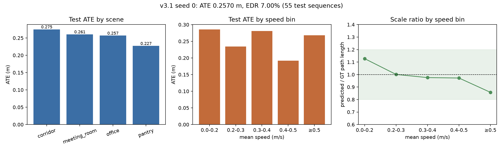

# P1 前向单目相机：仿真数据与融合模型初步结果

## 1. 数据链路

- 仿真传感器：`sim/models/tof_rig/model.sdf` 新增前向相机
  - 分辨率 **320×240**，L8 灰度，**15 Hz**
  - 主题 `/tio/camera_front`，水平 FOV 60°
- 录制：`record_sequence.py` 同时记录 4 路 64×64 深度、GT 和相机原始帧
- 后处理：`postprocess_sequence.py`
  - 相机按时间戳与 ToF/GT 对齐（容差 0.75/15 Hz = 50 ms）
  - 缩放到 **160×120**，JPEG q85
  - NPZ 新增 `camera_jpeg`（拼接字节）、`camera_offset`（T+1 偏移）、
    `camera_frame_valid`。这些是可选字段，不进入 `REQUIRED_ARRAYS`。

## 2. 相机数据集

配置：`configs/data/generation_camera.yaml`（v3.1 运动分布 + 相机）

| 项目 | 数值 |
|---|---:|
| 序列 | 355 |
| 总时长 | 8,975.3 s |
| 总路径 | 2,415.8 m |
| 总帧数 | 134,993 |
| split | train 246 / val 54 / test 55 |
| 相机覆盖 | 134,993 / 134,993 帧，缺失 0 |
| 平均 JPEG | 约 1.26 KB/帧 |
| 数据目录 | 322 MB |

审计结果：与 v3.1 相同，速度/步长分布、test 路径、ToF 有效率和重复轨迹
检查均通过；由于只有 355 条序列，速度 KS 和最小 bin 数量在 pilot 规模下
不满足 v3.1 的严格阈值。相机字段完整性为 100%。

## 3. 模型

- 新增 `CameraEncoder`：4 层 stride-2 CNN，输入当前帧 + 时间差分两通道，
  输出 128 维 token。
- 新增 `ReliabilityGate`：输入 IMU、相机、ToF 三个 token，输出 3 路 softmax
  权重，并加入 **IMU > camera > ToF** 的软先验 `[+1.5, 0, -1.0]`。
- 融合：
  `base = IMU-query cross-attention(ToF views)`
  `weighted = w_imu*h_imu + w_cam*h_cam + w_tof*h_tof`
  `out = Linear([base, weighted])`
- 相机是可选的；`camera_enabled: false` 时模型结构与 v3.1 完全一致。
- 参数量从 1,129,542 增加到 **1,278,937**。

## 4. 训练与评估

训练命令：

```bash
PYTEST_DISABLE_PLUGIN_AUTOLOAD=1 .venv/bin/python scripts/train.py \
  --processed data_cam/processed --out checkpoints_cam/pilot \
  --run-name seed0_e30 --seed 0 --epochs 30 \
  --batch-size 12 --workers 4 --camera
```

RTX 3060 6 GB 下 batch 32 会 OOM；batch 12 可稳定训练。

| 训练轮数 | 数据 | 测试序列 | ATE m | RPEp m | RPER ° | EDR % |
|---:|---|---:|---:|---:|---:|---:|
| 10 | data_cam | 55 | 0.3847 | 0.0130 | 0.263 | 10.33 |
| 30 | data_cam | 55 | **0.2570** | 0.0111 | 0.134 | 7.00 |
| 30 | v3.1 test（无相机输入，补零） | 141 | 0.2474 | 0.0111 | 0.155 | 6.46 |



30 epoch 后路径比：低速段 1.127，0.2–0.3 为 1.001，0.3–0.4 为 0.976，
0.4–0.5 为 0.972，≥0.5 为 0.858。尺度基本正常，但绝对误差仍明显高于
v3.1 的 0.0848 m。

## 5. 结论与限制

- 仿真相机采集、JPEG 存储、数据加载、相机融合、TorchScript 导出和
  C++/ROS 可选相机输入链路均已打通。
- 当前 9k s / 30 epoch pilot 的 ATE 0.257 m，**不能作为最终精度结论**：
  数据量只有 v3.1 的约 39%，训练轮数只有一半。
- 无相机输入时（v3.1 test 补零）ATE 0.247 m，说明模型没有把相机当作
  必需输入而崩溃；但相机分支的增益尚未验证。
- 下一步需要：
  1. 在完整 40k s 数据上重新生成带相机的版本；
  2. 加入 `tof_degraded_visual` 子集（ToF 大面积缺失、视觉可用）；
  3. 3 seeds × 100 epochs，比较有/无相机和 ToF 降级条件；
  4. 真实相机标定后再做 issue_5 回放。
