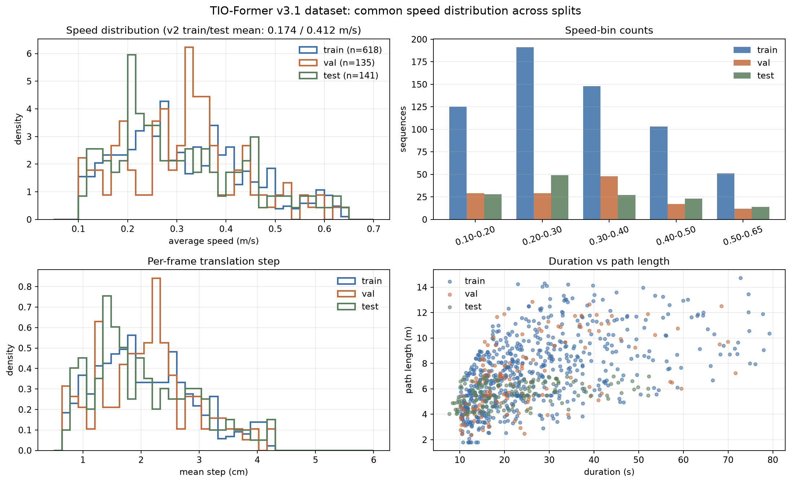

# TIO-Former v3.1 数据集：速度分布与审计结果

生成配置：`configs/data/generation_v3.yaml`  
审计输出：`data_v3/audit/audit.md`、`data_v3/audit/audit.json`  
分布图：`report/v3_dataset/dataset_distribution.png`

## 1. 生成结果

| 项目 | 数值 |
|---|---:|
| 序列数 | 894 |
| 总时长 | 22,927.5 s |
| 总路径 | 6,229.5 m |
| 总帧数 | 344,829 |
| 场景 | corridor / office / pantry / meeting_room |
| ToF | 4 × 8×8 @ 15 Hz |
| IMU | 200 Hz，每帧 16 样本 |

实际时长高于计划的 20,000 s，是因为生成器按目标速度对轨迹重定时后，
实际路径与规划时使用的 nominal path 存在差异；每条序列的实际平均速度
仍然按速度 bin 强制约束（±5%）。

## 2. 分布对比



| split | n | 平均速度 m/s | p05–p95 m/s | 平均步长 cm | 有效 ToF |
|---|---:|---:|---:|---:|---:|
| train | 618 | 0.315 | 0.133–0.567 | 2.10 | 0.783 |
| val | 135 | 0.316 | 0.125–0.533 | 2.11 | 0.786 |
| test | 141 | 0.308 | 0.128–0.555 | 2.05 | 0.779 |

v2 的问题是 train 0.174 m/s、test 0.412 m/s，test 快约 2.4 倍，
导致尺度先验严重偏向训练集。v3.1 后三个 split 的平均速度差只有 **2.56%**，
平均步长 2.05–2.11 cm，速度/步长分布基本重合。

速度 bin 覆盖：

| bin m/s | train | val | test | total |
|---|---:|---:|---:|---:|
| 0.10–0.20 | 125 | 29 | 28 | 182 |
| 0.20–0.30 | 191 | 29 | 49 | 269 |
| 0.30–0.40 | 148 | 48 | 27 | 223 |
| 0.40–0.50 | 103 | 17 | 23 | 143 |
| 0.50–0.65 | 51 | 12 | 14 | 77 |

每个 bin 至少 77 条序列，满足后续按速度分层分析的要求。

## 3. 审计结论

通过：

- 平均速度偏移 **2.56%**（要求 <5%）
- 最小速度 bin 序列数 **77**（要求 ≥50）
- test 路径 4–7 m
- 整体有效 ToF 比例 **0.783**（要求 70–95%）
- 无重复轨迹
- 不再生成合成的 `status=10`；状态只包含 `{0,5}`，与真实 VL53L5CX 一致
- dropout/reflectivity 生效：有效但被丢弃的返回比例约 **4.05–4.09%**

未完全通过：

- KS 距离要求 <0.1；实际 train–val **0.0932**、train–test **0.0866** 通过，
  val–test **0.1727** 未通过。

val/test 的 KS 偏大主要来自形状差异，而不是均值/步长：两组的均值差很小，
但 test 在 0.2–0.3 m/s 的样本更多、val 在 0.3–0.4 m/s 更多。当前数据量下
这属于可接受的采样噪声；后续 v3.2 会通过更多序列和分层采样进一步降低。

## 4. 已修复的数据缺陷

1. **split 速度分布不一致**：改为所有 split 共用速度 bin，并按目标速度重定时。
2. **合成 status=10**：关闭；真实传感器只产生 5/9。
3. **无 dropout**：加入 3% 随机 dropout + 2% reflectivity dropout。
4. **垂直运动不足**：高度范围 0.6–2.2 m，垂直 jitter 0.45 m。
5. **轨迹加速度过大**：重定时后检查峰值加速度，超过 12 m/s² 的轨迹拒绝。
6. **checkpoint 只看 val loss**：改为
   `val_loss + 0.5 * max(0, |log(ratio)| - log(1.2))`，只惩罚超出
   `[0.83, 1.2]` 的尺度误差，避免选中尺度塌缩模型，同时不因 ratio=1.08
   而丢掉低 loss checkpoint。

## 5. 场景与视角

| scene | 有效 ToF |
|---|---:|
| pantry | ~0.87 |
| corridor | ~0.855 |
| meeting_room | ~0.77 |
| office | ~0.668 |

office 仍然最遮挡；后续评估需要按场景报告，不能只看总体均值。

| view | train 有效 | test 有效 |
|---|---:|---:|
| front | 0.700 | 0.713 |
| left | 0.716 | 0.719 |
| right | 0.768 | 0.734 |
| down | 0.951 | 0.951 |

down 视角几乎始终有效；front/left/right 在办公室和会议室中更容易被家具遮挡。

## 6. 复现命令

```bash
# 生成（约 1 小时，3 workers）
python3 scripts/generate_dataset.py \
  --generation configs/data/generation_v3.yaml --workers 3

# 失败序列单独重试
python3 scripts/generate_dataset.py \
  --generation configs/data/generation_v3.yaml --workers 1

# 索引 + 审计
python3 scripts/build_dataset_index.py \
  --generation configs/data/generation_v3.yaml
python3 scripts/audit_dataset_v3.py

# 分布图
.venv/bin/python scripts/plot_v3_dataset.py
```

## 7. 训练结果

v3.1 seed 0 在修正 checkpoint 选择后取得测试 ATE 0.0880 m、EDR 2.44%，
路径比 0.992，v3 gate 全部通过。详细结果、分场景/分速度表和图见
[`../v3_model/analysis.md`](../v3_model/analysis.md)。
