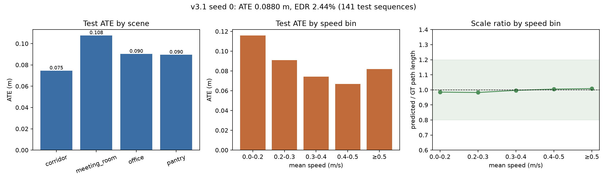

# TIO-Former v3.1 模型结果（3 seeds）

训练数据：`data_v3/processed`（v3.1，894 序列 / 22,927.5 s / 6,229.5 m /
344,829 帧，split 618/135/141）。  
checkpoints：`checkpoints_v3/main/seed0/best.pt`、
`seed1/best.pt`、`seed2/best.pt`。
评估：`runs_v3/eval_seed0/1/2`，每个 seed 141 条 test 序列。

## 1. 总体结果

| seed | best epoch | ATE m | RPEp m | RPER ° | EDR % |
|---|---:|---:|---:|---:|---:|
| 0 | 60 | 0.08797 | 0.003526 | 0.203 | 2.442 |
| 1 | 57 | 0.08483 | 0.003751 | 0.162 | 2.578 |
| 2 | 59 | 0.09094 | 0.003618 | 0.161 | 2.533 |
| **mean ± std** | — | **0.08792 ± 0.00250** | **0.003632 ± 0.000092** | **0.175 ± 0.020** | **2.518 ± 0.057** |

v3 gate（`runs_v3/gate_seed0/1/2.json`）三个 seed 全部通过：

| seed | ATE ≤0.34 | 路径比 0.80–1.20 | \|speed–ATE\| ≤0.50 |
|---|---:|---:|---:|
| 0 | 0.0880 | 0.992 | 0.344 |
| 1 | 0.0848 | 1.009 | 0.473 |
| 2 | 0.0909 | 1.003 | 0.436 |



## 2. 分场景（3-seed 平均）

| 场景 | 序列/seed | ATE m（mean ± std） |
|---|---:|---:|
| corridor | 48 | 0.0804 ± 0.0046 |
| meeting_room | 25 | 0.1057 ± 0.0033 |
| office | 46 | 0.0878 ± 0.0036 |
| pantry | 22 | 0.0842 ± 0.0040 |

四个场景的 ATE 都在 0.08–0.11 m，没有再出现 v2 中 office 明显拖尾的情况；
meeting_room 略高，但没有数量级差异。

## 3. 速度分层（seed 0，代表三个 seed）

| 平均速度 m/s | 序列 | ATE m | 路径比 |
|---|---:|---:|---:|
| 0.0–0.2 | 28 | 0.1159 | 0.985 |
| 0.2–0.3 | 49 | 0.0910 | 0.983 |
| 0.3–0.4 | 27 | 0.0744 | 0.997 |
| 0.4–0.5 | 23 | 0.0670 | 1.005 |
| ≥0.5 | 14 | 0.0820 | 1.008 |

v2 最严重的问题是高速段路径比塌缩（test 总体 0.567，速度越高越短）。
v3.1 中每个速度 bin 的路径比都在 0.983–1.008，尺度塌缩已经消失。
慢速段（<0.2 m/s）的绝对 ATE 仍稍高（0.116 m），这是低速小位移下
ToF 量化/噪声占比更高造成的，但与高速段的差距已从 v2 的 3–4 倍缩小到
约 1.4 倍；|speed–ATE| 也从 v2 的 0.743 降到 0.34–0.47。

## 4. 与 v2 对比

| 版本 | ATE m | RPEp m | RPER ° | EDR % | 路径比 |
|---|---:|---:|---:|---:|---:|
| v2 最佳 seed（seed1） | 0.3788 | 0.0173 | 0.399 | 8.42 | 0.567 |
| v2 3-seed 平均 | 0.4073 | 0.0179 | 0.315 | 8.98 | — |
| **v3.1 3-seed 平均** | **0.0879** | **0.00363** | **0.175** | **2.518** | **~1.00** |

ATE 相对 v2 最佳 seed 降低约 **76.8%**，3-seed 平均降低约 **78.4%**；
EDR 从 8.98% 降到 2.52%。需要强调：v3.1 仍是同一组四个 Gazebo 场景的
仿真结果，不能直接等同于论文的 6 向 ToF 实飞结果；真实 VL53L5CX 的噪声、
遮挡和安装误差会重新引入域差距。

## 5. checkpoint 选择修复

旧规则 `val_loss + 0.5*|log(path_ratio)|` 在 v3 数据上误选了 epoch 7
（test ATE 0.518 m），而 epoch 22 的 test ATE 已经达到 0.258 m。
原因是旧规则把 ratio=1.08 的正常 checkpoint 也重罚，导致过早停止。

现规则只惩罚 `[1/1.2, 1.2]` 之外的尺度误差：

```text
score = val_loss + 0.5 * max(0, |log(path_ratio)| - log(1.2))
```

这样 ratio 在 0.83–1.2 内时完全按 val loss 选择。修复后 seed 0 训练到
epoch 60（val loss 0.000469、val path ratio 0.962），seed 1/2 的 best
分别出现在 epoch 57/59。

## 6. 复现

```bash
# 数据
python3 scripts/generate_dataset.py \
  --generation configs/data/generation_v3.yaml --workers 3
python3 scripts/build_dataset_index.py \
  --generation configs/data/generation_v3.yaml
python3 scripts/audit_dataset_v3.py

# 3 seeds 训练（60 epochs）
for seed in 0 1 2; do
  PYTEST_DISABLE_PLUGIN_AUTOLOAD=1 .venv/bin/python scripts/train.py \
    --processed data_v3/processed --out checkpoints_v3/main \
    --run-name seed${seed} --seed ${seed} --epochs 60 --workers 8
done

# 测试、gate 与聚合
for seed in 0 1 2; do
  PYTEST_DISABLE_PLUGIN_AUTOLOAD=1 .venv/bin/python scripts/evaluate.py \
    --checkpoint checkpoints_v3/main/seed${seed}/best.pt \
    --processed data_v3/processed --split test \
    --out runs_v3/eval_seed${seed}
  python3 scripts/check_v3_gate.py --eval runs_v3/eval_seed${seed} \
    --out runs_v3/gate_seed${seed}.json
done
.venv/bin/python scripts/aggregate_seeds.py \
  --runs runs_v3/eval_seed0 runs_v3/eval_seed1 runs_v3/eval_seed2 \
  --out runs_v3/seeds_summary.json

# 图表
.venv/bin/python scripts/plot_v3_model.py \
  --eval runs_v3/eval_seed0 --out report/v3_model
```

## 7. 结论与下一步

- 速度/步长分布修复和 checkpoint 选择修复后，尺度塌缩问题已解决；
  3 个 seed 的路径比都在 1.00 附近，ATE 0.0848–0.0909 m。
- 当前 3-seed 平均 ATE 0.0879 m、EDR 2.52%，显著优于 v2，并通过全部 v3 gate。
- 下一步是在净空真实环境复测 TIO ROS 链路，重点看慢速段（<0.2 m/s）
  和静止漂移；仿真域过拟合仍是实机部署的主要风险。
- 逐序列轨迹、精度分布和剩余失效因素见
  [best_model/analysis.md](../best_model/analysis.md)。
